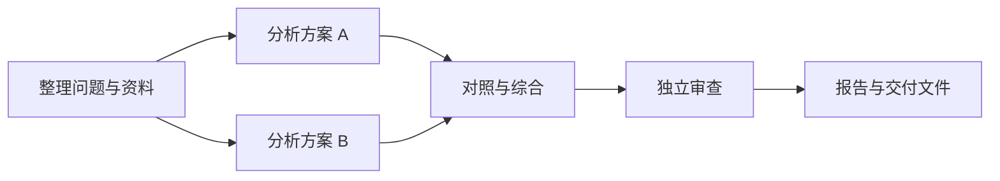
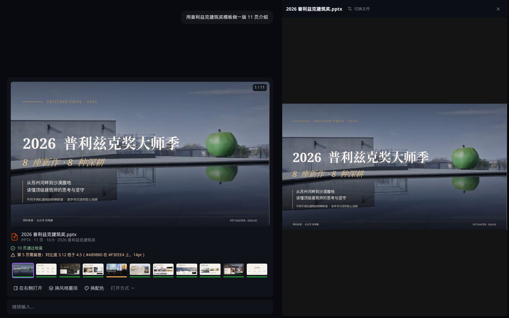

<p align="center">
  
</p>

<h1 align="center">Selection</h1>

<p align="center">
  在桌面上组织 AI 会话，让多个智能体协作完成复杂工作。
</p>

<p align="center">
  <a href="LICENSE"></a>
  <a href="https://github.com/0-CHENAI/Selection/releases"></a>
</p>

<p align="center">
  <a href="#pro-模式让复杂工作有计划地推进">PRO 模式</a> ·
  <a href="#安装">下载安装</a> ·
  <a href="#快速上手">快速上手</a> ·
  <a href="#功能一览">功能一览</a> ·
  <a href="#从源码运行">从源码运行</a>
</p>

Selection 是基于 [Craft Agents](https://github.com/craft-ai-agents/craft-agents-oss) 开发的开源 AI 桌面应用。你可以同时推进多个会话，把相关资料和文件归入项目，接上自己的模型与数据源，让智能体直接参与手头的工作。

Selection 提供 **NORM / PRO 两种工作模式**：日常任务在会话中直接完成；复杂工作可以通过 **Swarm 多智能体协作**和 **DAG 任务编排**组织分工、依赖、验证与交付。同时，你也可以在应用内预览和修改 Word、Excel、PowerPoint，或从资料生成可编辑的 PPTX。

## 为什么做 Selection

一项工作往往需要反复查资料、调用工具、修改文件，再检查结果。会话多了，还要分清每件事的上下文、工作目录和进度。

Selection 把这些环节放在同一个桌面工作空间里：日常问题在一段会话中完成，复杂任务可以拆分协作，按依赖推进，并在交付前检查结果。你能看到任务怎样执行、哪里遇到问题，以及接下来需要做什么。

## PRO 模式：让复杂工作有计划地推进

| 工作模式 | 适合的任务 |
| --- | --- |
| **NORM** | 问答、阅读资料、修改文件，以及在当前会话中直接完成的工作 |
| **PRO** | 需要多个智能体分工、任务依赖、独立审查或持续推进的复杂工作 |

在 PRO 中，可以从一个目标开始，由协调会话组织工作，再根据任务需要采用 Swarm 协作或建立 DAG 计划。

### Swarm：按需要组织多智能体分工

当任务包含可以独立推进的工作时，协调会话可以把它们委派给多个智能体。例如，分别查阅不同来源、分析不同方案，或检查不同模块，再汇总成一份结果。

每项分工都有明确的输入、预期产出和证据要求。子智能体使用独立会话执行，协调会话负责汇总结果、处理冲突并说明未完成的部分。遇到阻塞时，子任务可以向协调会话求助，在得到答复后继续原任务。只有符合拆分条件、并行有实际收益时才会创建分工。

### DAG：把任务依赖变成可执行的计划

DAG（有向无环图）用任务节点和依赖关系描述一项工作：哪些步骤可以并行，哪些必须等待前面的结果，以及哪些输出需要审查后才能继续。节点可以使用不同的模型与连接，并明确各自的输入、输出和验收要求。

例如，一项方案对比任务可以组织成这样的依赖图：



两条分析分支可以并行推进，综合节点等待双方输出，审查通过后再进入交付。你可以在工作台中查看任务图，编辑节点、模型与依赖，也可以让 AI 协助生成或调整计划。

Swarm 负责按需委派与协作，DAG 负责显式的步骤和依赖。PRO 将它们与执行状态、成果和审查记录放在一起，方便从整体目标追踪到具体任务。

### 从执行到交付，保留检查与修正的过程

| 能力 | 对实际工作的帮助 |
| --- | --- |
| 动态调整计划 | 发现资料缺口时，可以补充尚未执行的任务或调整依赖，保留已经完成的记录 |
| 验证与修正 | 可配置验证节点和验收条件；审查指出具体问题时，重新执行相关任务及受影响的后续步骤，保留无关分支的有效成果 |
| 深度研究 | 记录原文、结论与来源版本，让研究者和独立审查者分别核对依据；报告呈现已支持的结论、资料缺口与未解决问题 |
| 执行过程回看 | 查看计划修订、任务状态和执行记录，了解当前结果来自哪些步骤 |
| 暂停与恢复 | 保存运行检查点，中断后核对状态再继续，保留已确认的成果和历史 |
| 预算与权限 | 在配置的并发、预算和权限范围内执行，需要审批或补充预算时等待处理 |
| 会话交接 | 将当前成果、背景和未解决问题交给新的 NORM 或 PRO 会话，继续下一阶段工作 |

项目还可以显式开启 **PRO 历史检索**，让后续任务按需查阅相关会话原文。新会话不会自动加载项目里的全部历史。

任务定义、运行控制与配置说明见[编排使用指南](packages/shared/src/tasks/USER-GUIDE.md)。

## 你可以直接这样用

### 「帮我看这份文件，再按要求修改」

附上文件或选择工作目录，让智能体阅读资料、整理表格、修改文稿。Word、Excel 和 PowerPoint 可以在右侧的 **Office 协同**中预览，也可以点选段落、单元格或形状，提出具体修改要求。文件的修改结果和版本历史保留在会话中。

### 「把这些资料做成一套演示文稿」

从侧栏或输入栏的 **PPT** 入口选择模板，说明主题、受众和页数，也可以附上参考资料或导入自己的 PPTX 模板。生成过程会打开右侧预览，完成后得到可编辑的 PPTX；还可以继续调整内容、风格和配色。

<p align="center">
  
</p>

<p align="center"><sub>从对话生成演示文稿，在右侧预览和继续修改同一份 PPTX。</sub></p>

### 「把我已有的工具和数据接进来」

数据源支持远程与本地 MCP、REST API 和本地目录。你可以提供 MCP 配置、API 文档或文件夹位置，由智能体协助配置，并在需要时完成授权。对话中用 `@` 引用数据源或技能。

### 「以后都按这个方法做，到时间自动执行」

把常用流程写成技能，在后续会话中复用。需要定期执行时，可以配置自动化，例如「每个工作日早上 9 点整理一份简报」。目前支持定时和应用事件触发，配置说明见[自动化文档](apps/electron/resources/docs/automations.md)。

## 安装

前往 [GitHub Releases](https://github.com/0-CHENAI/Selection/releases) 下载本仓库发布的安装包：

| 系统 | 安装包 |
| --- | --- |
| macOS · Apple 芯片 | `Selection-arm64.dmg`，也提供 `.zip` |
| Windows · x64 | `Selection-x64.exe` |

`test` 分支的构建以 **beta / prerelease** 发布。请根据发布说明选择版本，安装包、校验和与构建信息以对应 Release 的附件为准。

其他平台可参考[从源码运行](#从源码运行)。当前桌面安装包 CI 覆盖 macOS ARM64 和 Windows x64。

## 快速上手

1. **打开应用，配置模型。** 首次启动可选择 ORDER、其他提供商或本地模型，也可以先跳过，稍后在设置中添加连接。
2. **选择工作模式。** 用 NORM 处理日常任务；需要 Swarm 分工、DAG 编排或研究审查时，切换到 PRO。
3. **提供资料与工作目录。** 附上文件，或选择智能体需要使用的文件夹。同一项工作的多个会话可以归入项目。
4. **按需连接数据源和技能。** 添加 MCP、API 或本地目录，再通过 `@` 引用。
5. **查看执行过程和结果。** 在对话中查看工具调用与文件结果；处理 Office 文件时，可打开右侧预览继续修改。

例如，可以从这样一个任务开始：

> 阅读我上传的销售表格，核对各区域的汇总数据，整理主要变化，并生成一份复盘文档。缺少的信息请明确标出。

## 功能一览

| 能力 | 用途 |
| --- | --- |
| 多会话管理 | 同时推进不同任务，用状态、旗标和搜索管理会话 |
| NORM / PRO | 在日常对话与任务编排之间选择合适的工作方式 |
| Swarm 协作 | 按任务需要组织多个智能体分工，由协调会话汇总和处理阻塞 |
| DAG 编排 | 定义步骤与依赖，执行并行分支、验证和受影响任务的修正 |
| 深度研究 | 追踪来源与结论版本，独立审查，并披露依据和资料缺口 |
| 项目 | 集中管理相关会话、工作目录和参考资料 |
| Office 协同 | 预览并修改 Word、Excel、PowerPoint，支持选中内容后提出修改要求 |
| 演示文稿 | 从资料与模板生成可编辑 PPTX，预览各页并调整风格和配色 |
| 数据源 | 连接远程 MCP、本地 stdio MCP、REST API 和文件目录 |
| 技能 | 保存专用指令和工作方法，支持工作区自定义技能 |
| 自动化 | 根据时间或应用事件触发任务 |
| 文件与版本 | 查看会话文件、修改结果和版本历史 |
| 多模型连接 | 配置多个提供商、私有网关或本地模型 |
| 界面定制 | 中英文等多语言界面，以及应用和工作区主题 |

### 模型连接

Selection 使用 **Pi** 作为智能体运行时。你可以在设置中添加多个连接，按任务选择模型。

| 连接方式 | 示例 |
| --- | --- |
| 私有网关 | 首次启动中的 ORDER 入口，或自定义服务地址 |
| API Key | OpenAI、Google AI Studio、OpenRouter、Kimi 等 |
| 订阅授权 | ChatGPT（Codex OAuth）、GitHub Copilot |
| 自定义端点 | OpenAI Compatible 或 Anthropic Messages |
| 本地模型 | Ollama 等本机服务 |

可用模型和授权方式以应用中的连接选项及提供商权限为准。Anthropic Messages 自定义端点与官方 API Key 可用；官方 Anthropic 登录和 Claude Max OAuth 不在当前支持范围内。

### 权限控制

默认使用 **智能审批**。在输入区按 `Shift+Tab` 可以切换权限模式。

| 模式 | 行为 |
| --- | --- |
| 只读探索 | 阅读、检索与分析，阻止写入操作 |
| 智能审批 | 低风险操作自动执行，高风险或无法判断的操作请求确认 |
| 完全接管 | 自动执行操作；首次在工作区启用时需要确认风险提示 |

工作区和数据源可以配置更细的规则，详见[权限文档](apps/electron/resources/docs/permissions.md)。

### 本地数据

配置与会话默认保存在用户目录下的 `~/.selection/`，包括模型连接、加密凭据、工作区、项目、会话、数据源和技能。Windows 对应 `%USERPROFILE%\.selection\`。

凭据使用 AES-256-GCM 加密存储。模型请求和数据源调用会按你的配置发送到对应服务；本地保存会话不代表所有处理都在本机完成。

开发时可通过 `CRAFT_CONFIG_DIR` 指定独立的数据目录。

## 从源码运行

需要 **Git、Bun 和 Node.js 18+**。当前 CI 使用 Bun **1.3.10**。Windows 执行 shell 工具还需要 Git Bash，可随 [Git for Windows](https://git-scm.com/downloads/win) 安装。

```bash
git clone --branch test https://github.com/0-CHENAI/Selection.git
cd Selection
bun install --frozen-lockfile
bun run electron:dev
```

`electron:dev` 启动桌面应用并启用界面热更新。首次运行会按需下载当前平台的 uv 和 OfficeCLI，因此需要能够访问相关下载服务。

构建后启动：

```bash
bun run electron:start
```

模型与数据源凭据在应用内配置。开发构建中的 Slack、Microsoft 等可选 OAuth 参数可参考 [`.env.example`](.env.example)，无需为了启动桌面应用填写其中所有变量。

### 开发与检查

在仓库根目录执行：

| 命令 | 作用 |
| --- | --- |
| `bun run electron:dev` | 启动热更新开发环境 |
| `bun run electron:build` | 构建桌面应用 |
| `bun run typecheck:all` | 全仓库类型检查 |
| `bun run lint` | 代码与仓库规则检查 |
| `bun run test` | 运行仓库测试脚本 |
| `bun run validate:dev` | 类型、界面启动、共享模块与文档工具检查 |
| `bun run officecli:check` | 检查内置 OfficeCLI 运行时与资源 |

完整验证还需要可用的 Bash 和 uv；Windows 可使用 Git Bash 执行依赖 Bash 的脚本。

### 构建安装包

按目标平台选择命令，产物输出到 `apps/electron/release/`：

```bash
bun run electron:dist:mac
bun run electron:dist:win
bun run electron:dist:linux
```

仓库另有 `scripts/package-desktop.ts`，用于 CI 的 macOS ARM64 / Windows x64 打包流程，汇总产物输出到 `dist-packages/`。

### 代码结构

```text
apps/
├── electron/             # 桌面应用：Electron + React
├── cli/                  # 终端客户端
├── viewer/               # 会话分享查看器
└── webui/                # 无头服务的 Web 界面
packages/
├── core/                 # 共享类型
├── shared/               # 模型、权限、配置、数据源等公共逻辑
├── ui/                   # 公共界面组件
├── server-core/          # 会话管理与 RPC 处理
├── server/               # 独立无头服务
├── pi-agent-server/      # Pi 智能体子进程
└── session-tools-core/   # 会话工具实现
```

部分 npm 包和环境变量沿用上游的 `@craft-agent/*`、`CRAFT_*` 命名。

## 文档与参与

- 使用指南：[数据源](apps/electron/resources/docs/sources.md) · [技能](apps/electron/resources/docs/skills.md) · [自动化](apps/electron/resources/docs/automations.md) · [权限](apps/electron/resources/docs/permissions.md) · [主题](apps/electron/resources/docs/themes.md)
- 文档能力：[OfficeCLI](apps/electron/resources/skills/officecli/SKILL.md) · [演示文稿](apps/electron/resources/skills/ppt-design/SKILL.md)
- 问题反馈：[GitHub Issues](https://github.com/0-CHENAI/Selection/issues)
- 参与开发：[贡献指南](CONTRIBUTING.md) · [行为准则](CODE_OF_CONDUCT.md)
- 安全问题：[安全政策](SECURITY.md)，请勿在公开 Issue 中披露凭据或漏洞细节。

本分支的开发环境、克隆地址和启动命令以本文为准。提交改动时请使用中文说明，并优先向 `test` 分支发起 Pull Request。

## 许可与致谢

Selection 基于 [Craft Agents OSS](https://github.com/craft-ai-agents/craft-agents-oss) 继续开发，代码采用 [Apache License 2.0](LICENSE)。感谢上游项目及开源贡献者。

第三方声明见 [NOTICE](NOTICE)，上游名称与标志的使用规则见 [TRADEMARK.md](TRADEMARK.md)。PPT 模板与参考素材保留各自的许可和署名，详见[模板来源说明](apps/electron/resources/skills/ppt-design/ATTRIBUTION.md)。
