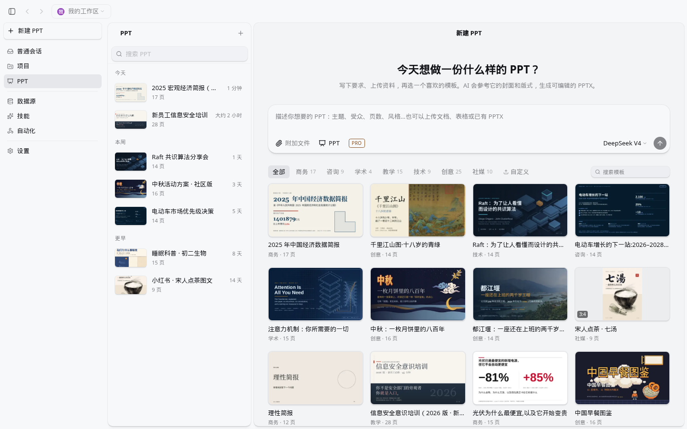
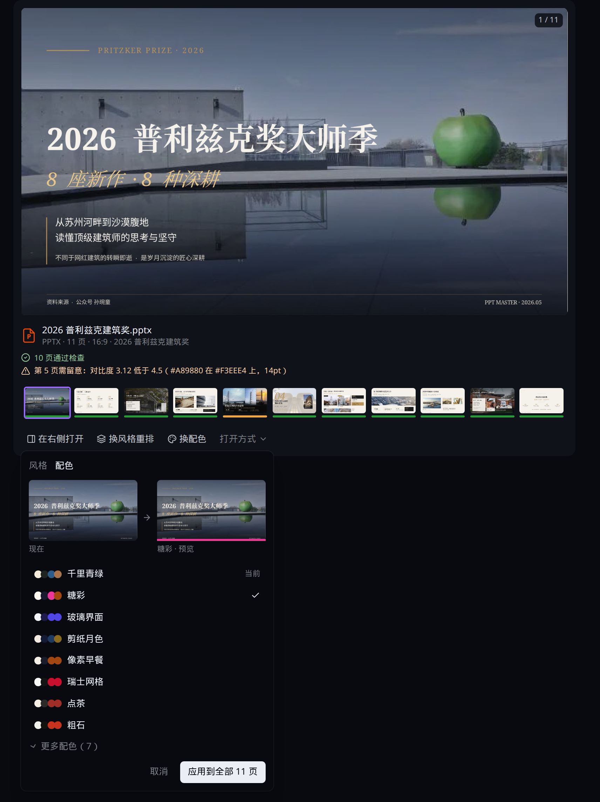
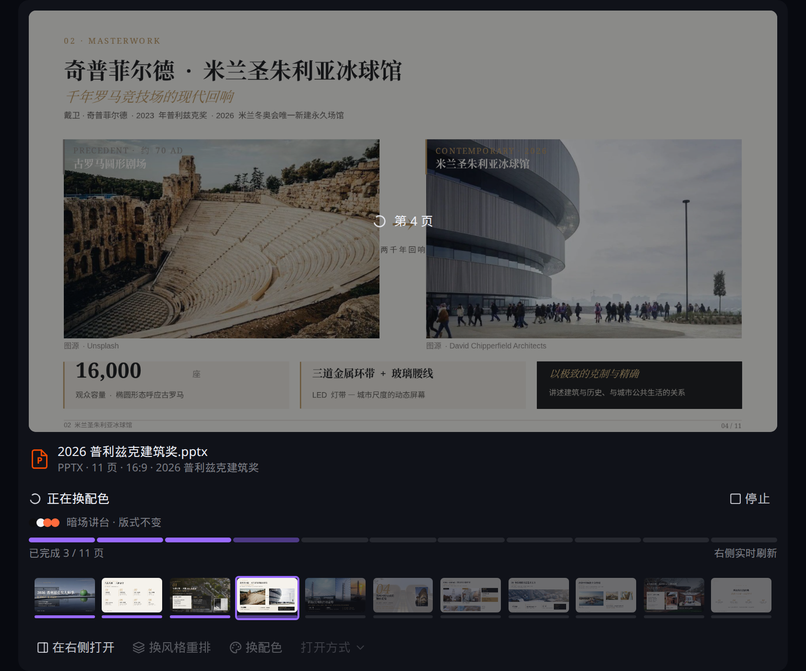
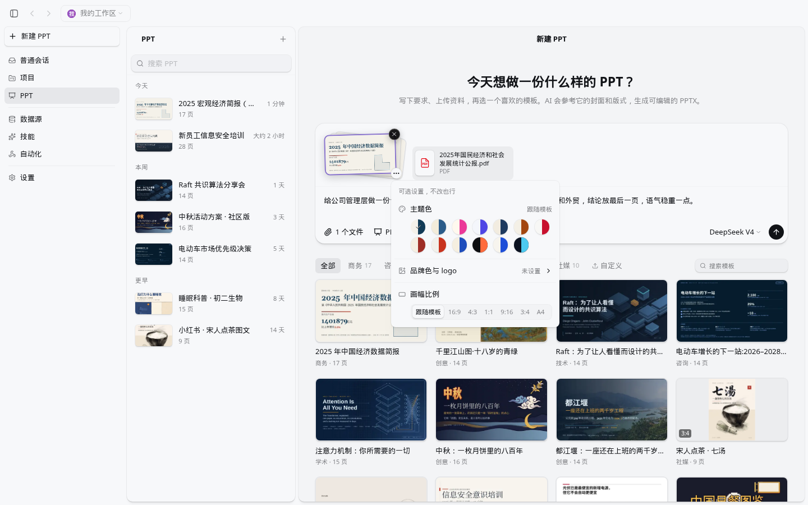
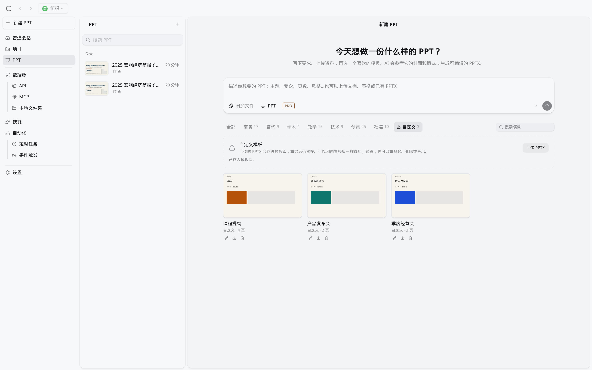
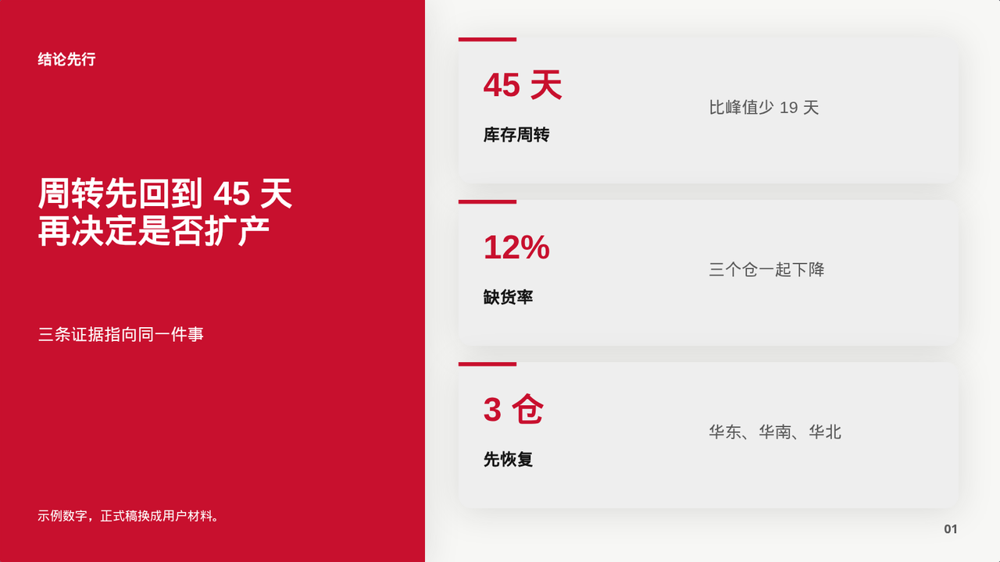
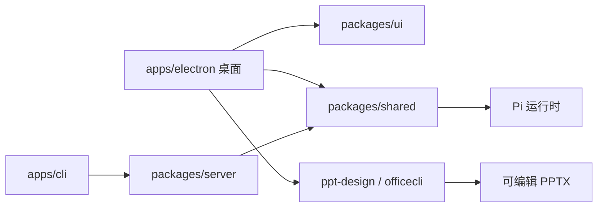

<p align="center">
  
</p>

<h1 align="center">Selection</h1>

<p align="center">
  桌面上的多智能体会话。<br />
  资料、工具和成稿放在同一处，演示文稿可以一边生成一边看。
</p>

<p align="center">
  <a href="LICENSE"></a>
  <a href="apps/electron"></a>
  <a href="https://bun.sh"></a>
  <a href="apps/electron/resources/skills/ppt-design/SKILL.md"></a>
</p>

<p align="center">
  <a href="https://github.com/0-CHENAI/Selection">github.com/0-CHENAI/Selection</a>
  · 当前仓库版本 3.1
</p>

> [!TIP]
> 第一次来，先看下面的深色分栏，再按 [从源码跑起来](#从源码跑起来) 克隆。想直接做幻灯片，跳到 [演示文稿](#演示文稿)。

## 打开就是这样

深色主题下，生成结束的一屏是这样：左边展开结果卡，右边是同一份 PPTX 的 Office 协同预览。


> 结果卡上有封面、检查摘要和缩略图。右侧顶栏是文件名和「切换文件」。点缩略图或「在右侧打开」，预览跟到那一页。

浅色主题里，普通会话的中间列是会话列表。输入栏的 **PPT** 会弹出模板选择器，选中后带着这段对话去做幻灯片。


> 会话按今天、昨天分组。选择器里能搜模板，也可以去「查看全部模板」。

PPT 还有自己的入口。左侧点 **PPT**，历史在中间，模板画廊在右边。



> 标题就是现在的文案：「今天想做一份什么样的 PPT？」。这张浅色整窗图拍摄时，输入区还没有后来补上的数据源和工作目录，那两项现在可以一起选。

## Selection 是什么

Selection 给想在桌面里跟智能体一起干活的人用：同时开很多会话，接上自己的工具和文件，最后把结果留在工作区里。它特别照顾一条经常被聊天工具丢掉的路径：从一份资料做成一套可以打开、可以改的演示文稿。

适合这些场景：

- 手上有纪要、表格或旧 PPT，想整理成一套新的幻灯片
- 要同时盯几件任务，每件留在自己的会话里
- 模型要换来换去：私有化网关、各家 API、本机 Ollama
- 愿意从源码构建，自己改技能和界面

上面有深色和浅色两套中文界面。仓库里还有英、德、西、日、波、匈等语言包。

## 从哪来

Selection 在 [Craft Agents OSS](https://github.com/craft-ai-agents/craft-agents-oss) 上继续开发，许可证仍是 Apache-2.0。GitHub 仓库简介里的 “secondary development of Craft Agent” 指的就是这段来源。

桌面产品名是 Selection，配置放在 `~/.selection/`。演示文稿、Office 协同和结果卡是这条线上继续做出来的工作流。安装和文档以本仓库为准。

## 现在能做什么

| 你要做的事 | Selection 里怎么做 |
| --- | --- |
| 同时推进多件事 | 工作区里的会话列表，带状态、旗标和搜索 |
| 接上外部系统 | 来源：MCP、REST API、本地目录 |
| 把做法存下来 | 工作区技能，对话里用 `@` 提到 |
| 换模型 | 首次启动选 ORDER、其他提供商或本地模型；运行时是 Pi |
| 做一套新幻灯片 | PPT 模式：模板、`ppt-design`、增量导出的 PPTX |
| 改已有 Office 文件 | 右侧 **Office 协同**，Word、Excel、PowerPoint 都能预览和点选 |
| 看生成结果 | `PptResultCard`：默认一行摘要，展开后是封面、缩略图、换风格、换配色 |

内置技能：

| 技能 | 用在 |
| --- | --- |
| [`ppt-design`](apps/electron/resources/skills/ppt-design/SKILL.md) | 新建整套演示文稿，或整套重设计 |
| [`officecli`](apps/electron/resources/skills/officecli/SKILL.md) | 检查、改写、截图已有的 Word、Excel、PowerPoint |
| `natural-writing` | 中文成稿 |
| `humanizer` | 英文成稿 |
| `academic-humanizer` | 英文学术文本 |
| `deep-research` | 带研究角色的 PRO 任务节点 |

工作区里还可以放你自己的技能。局部修改旧 PPT 走 OfficeCLI，整套新稿走 `ppt-design`。

## 演示文稿

一条新文稿大致是这样走的：

| 步骤 | 界面上 |
| --- | --- |
| 进入 | 左侧 **PPT**，或普通会话输入栏的 **PPT** |
| 选模板 | 画廊按商务、咨询、学术、教学、技术、创意、社媒分类；**自定义**里可以上传 PPTX |
| 写要求 | 主题、受众、页数、风格；可以附文件，也可以选数据源和工作目录 |
| 生成 | 自动打开平时的 **Office 协同**。真实 PPTX 出现之前，面板停在「正在加载预览」；页写进 deck 后，预览跟着这份文件刷新 |
| 看结果 | 结果卡默认收成一行：文件名、页数和检查结果、「在右侧打开」。展开后才是封面、缩略图、换风格重排、换配色 |
| 拿文件 | 只留一份可编辑 PPTX。文件名来自标题。没选工作目录时写在会话文件夹，选了就写在该目录。绝对路径记在会话 `data/ppt-output.json` |

展开后的结果卡把封面放大，检查结果写在文件名下面，缩略图一条排开。通过的页是绿条，需要留意的页会标出来。


> 这一份示例文稿是 11 页。摘要写着 10 页通过，第 5 页需要留意。

换配色时先看「现在」和「预览」，再从列表里选一套颜色，应用到全部页面。



> 配色只换颜色。版式和文字留在原来的位置。列表里还能展开更多配色。

换配色进行中，封面上标着正在重画的那一页，下面是进度条和「已完成 n/N 页 · 右侧实时刷新」。



> 正在重画的那一页盖着页码。缩略图随每一页的新画面更新。

选中模板之后，`⋯` 里可以改主题色、品牌色与标志、画幅。再选一个模板会换成当前这一张。



> 主题色只换颜色和字体。画幅可以是 16:9、4:3、1:1、9:16、3:4 或 A4。

自己的 PPTX 会进模板库，重启后还在，可以预览、重命名、删除或导出。文件在 `~/.selection/ppt-templates/custom-…/`。



历史列表按今天、本周、更早分组，可以搜索。每一行沿用普通会话的菜单：重命名、标为未读、在新窗口打开、发送到其他工作区、归入项目、删除。Office 协同打开时，中间这列会先让出宽度；你手动展开或收起之后，这次选择会保持到你再改。

风格和版式是内置的，说明在技能目录里：

- [风格索引](apps/electron/resources/skills/ppt-design/references/styles.md)：5 套 DSH 风格，每套有中文和英文各 12 页参考（画布 960×540 pt）；另有 14 套由 ppt-master 转入的风格
- [12 套自有配色](apps/electron/resources/skills/ppt-design/styles/themes/catalog.json)：只换颜色和字体，不改页面结构
- [7 套结构版式](apps/electron/resources/skills/ppt-design/references/layouts.md)：16:9、4:3、方形、9:16、3:4
- 14 个论证版式（结论、证据树、矩阵、瀑布、趋势、计分、甘特、架构、对照、漏斗、流程、时间线、收束、取舍），仍是 960×540

下面是论证版式里的结论页。页脚写着「示例数字」，正式稿会换成你的材料。



导出用技能自带的 PptxGenJS（`engine/deck-cli.mjs`），不要求另外安装 Python。导出后的检查、读回、截图和定点修改交给随应用打包的 OfficeCLI。

## 权限、快捷键、来源、模型

权限有三档，默认是 **智能审批**。在输入区按 `Shift+Tab` 循环。

| 模式 id | 界面名称 | 行为 |
| --- | --- | --- |
| `safe` | 只读探索 | 阻止写入，不再逐项询问 |
| `ask` | 智能审批 | 低风险操作自动执行，高风险操作等你点头 |
| `allow-all` | 完全接管 | 自动执行，不再确认 |

macOS 用 `⌘`，Windows 和 Linux 用 `Ctrl`。下表按 macOS 书写。

| 快捷键 | 作用 |
| --- | --- |
| `⌘N` | 新建聊天 |
| `⌘T` | 在新面板新建聊天 |
| `⌘,` | 设置 |
| `⌘F` | 搜索 |
| `⌘/` | 快捷键列表 |
| `⌘1` / `⌘2` / `⌘3` | 焦点到侧栏 / 列表 / 聊天 |
| `⌘B` | 沉浸模式：藏起左侧导航和列表 |
| `Shift+Tab` | 切换权限模式 |
| `Enter` | 发送 |
| `Shift+Enter` | 换行 |
| `Esc` `Esc` | 停止当前任务（连按两次） |

来源只有三种，定义在 `packages/shared`：

| 类型 | 例子 |
| --- | --- |
| `mcp` | 远程 MCP，或本机 stdio（`npx`、Python、本地二进制） |
| `api` | REST。Google、Slack、Microsoft 走各自的 OAuth；也可以贴 OpenAPI |
| `local` | 文件夹、笔记库、Git 仓库 |

模型连接都进 Pi 运行时。第一次打开会先问你怎么接：

| 入口 | 说明 |
| --- | --- |
| ORDER | 私有化网关，地址是 `https://order.ai.jxepdi.top` |
| 使用其他提供商 | OpenRouter、Google AI Studio，以及其他 OpenAI 兼容 API |
| 本地模型 | Ollama 等。有服务地址就可以，不必填 Key |
| 稍后设置 | 先进入工作区，连接以后再补 |

设置里还可以加 ChatGPT（Codex OAuth）、GitHub Copilot、Kimi，以及 OpenAI 兼容或 Anthropic Messages 自定义端点。官方 API Key 可以把 Anthropic Messages 端点指到 `https://api.anthropic.com`。官方 Anthropic 登录和 Claude Max OAuth 不在这条运行时里。Amazon Bedrock、Google Vertex 也走同一套 Pi 连接。

## 从源码跑起来

需要 [Bun](https://bun.sh/)（`packages/server` 声明 `bun >= 1.0.0`）和 Node.js 18+。系统可以是 macOS、Linux 或 Windows。请从本仓库克隆后构建。

```bash
git clone https://github.com/0-CHENAI/Selection.git
cd Selection
bun install
bun run electron:dev
```

`electron:dev` 会编译主进程、起界面的热更新，并按当前平台准备随应用打包的 uv 和 OfficeCLI，所以第一次启动需要能下载这些运行时。

只想构建一次再打开：

```bash
bun run electron:start
```

本地安装包（产物在 `apps/electron/release/`，文件名形如 `Selection-arm64.dmg`）：

```bash
bun run electron:dist:mac
bun run electron:dist:win
bun run electron:dist:linux
```

桌面能启动，不依赖仓库根目录的 `.env`。要在开发构建里写入 Slack 或 Microsoft 的 OAuth Client ID，可以参考 [`.env.example`](.env.example) 里对应的字段。`.env.example` 开头的 Anthropic 和 Craft MCP 变量是上游留下的，跑 Selection 桌面不必填。Google 类来源的凭据在添加来源时由使用者自己填写。

## 第一次打开

1. 还没有任何工作区时，应用会创建 **My Workspace**，目录是 `~/.selection/workspaces/my-workspace`。
2. 还没有可用的模型连接时，进入欢迎向导：选择 ORDER、其他提供商或本地模型，也可以稍后设置。Windows 上如果缺少 Git Bash，向导会先提示。
3. 进入会话后直接聊天。做幻灯片时打开左侧 **PPT**，或在普通会话里点 **PPT**。
4. 权限默认是智能审批。需要完全只读或完全自动时，用 `Shift+Tab` 换。

## 数据放在哪

默认目录是 `~/.selection/`。多开开发时可以用环境变量 `CRAFT_CONFIG_DIR` 指到别处，例如 `~/.selection-1`。旧数据如果还在 `~/.craft-agent`，把 `CRAFT_CONFIG_DIR` 指过去即可继续用，不必先搬家。

```text
~/.selection/
├── config.json                 # 工作区列表、模型连接
├── credentials.enc             # AES-256-GCM 加密的凭据
├── preferences.json
├── theme.json
├── ppt-templates/              # 自定义 PPT 模板，目录名 custom-<16位hex>/
├── logs/
│   ├── messaging-gateway.log
│   └── auto-update.log
└── workspaces/
    └── my-workspace/
        ├── config.json
        ├── automations.json    # 有自动化时才会出现
        ├── sessions/
        ├── sources/
        ├── skills/
        └── statuses/
```

自动化写在工作区的 `automations.json` 里，也可以直接对智能体说「每个工作日早上 9 点做一份简报」。开发模式下主进程会写调试日志；打包后的程序名是 Selection，需要详细日志时给可执行文件加上 `--debug`。

## 开发

常用命令都在仓库根目录的 `package.json` 里：

| 命令 | 作用 |
| --- | --- |
| `bun run electron:dev` | 热更新开发 |
| `bun run electron:start` | 构建并启动 |
| `bun run typecheck:all` | 全仓库类型检查 |
| `bun run lint` | ESLint 与仓库脚本检查 |
| `bun run test` | `scripts/run-tracked-tests.sh` |
| `bun run validate:dev` | 类型检查、启动检查和一组共享测试 |
| `bun run electron:dist:mac` | 打 macOS 包（另有 `:win`、`:linux`） |



产品名是 Selection。npm 包仍使用分叉时的作用域 `@craft-agent/*`，根包名是 `craft-agent`。克隆和运行按上面的地址即可。

<details>
<summary>同仓库里的终端客户端和无头服务</summary>

桌面是主要入口。需要脚本或无头进程时：

```bash
bun run server:start
bun run apps/cli/src/index.ts --help
```

服务默认听 `9100`（`CRAFT_RPC_PORT`）。终端客户端的二进制名仍是 `craft-cli`，用 `--url` / `--token`，或环境变量 `CRAFT_SERVER_URL`、`CRAFT_SERVER_TOKEN` 连接。把 `CRAFT_SERVER_URL` 设上之后，Electron 会作为连接到该服务的窗口启动。

</details>

## 许可与参与

代码以 [Apache License 2.0](LICENSE) 授权。第三方声明见 [NOTICE](NOTICE)。

参与方式见 [CONTRIBUTING.md](CONTRIBUTING.md)。那份文档里的克隆地址还写着上游仓库，请以本文的 `https://github.com/0-CHENAI/Selection.git` 为准。行为准则见 [CODE_OF_CONDUCT.md](CODE_OF_CONDUCT.md)。安全问题见 [SECURITY.md](SECURITY.md)，不要开公开 issue。

Craft、Craft Agents 的名称和标志仍属于上游项目，使用边界写在 [TRADEMARK.md](TRADEMARK.md)。Selection 是本仓库的产品名。
