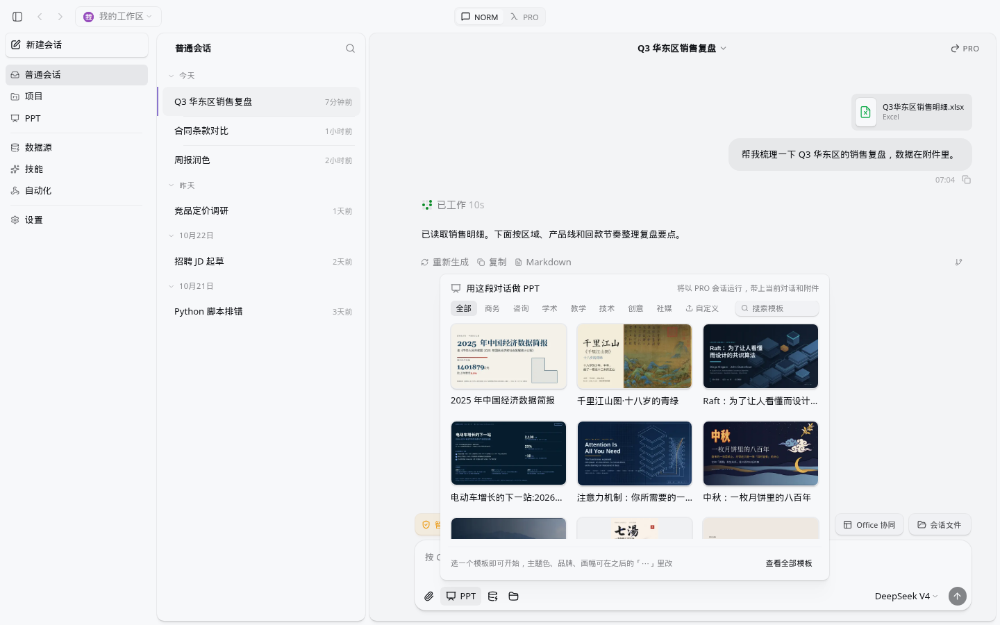
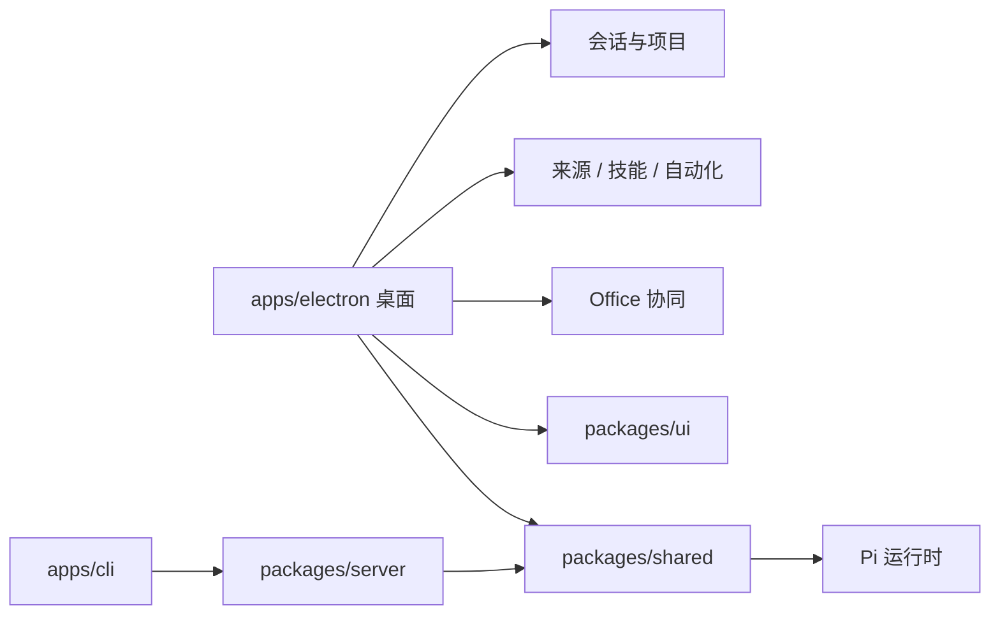

<p align="center">
  
</p>

<h1 align="center">Selection</h1>

<p align="center">
  桌面上的多智能体会话。<br />
  很多会话、项目、数据源和技能放在同一处。
</p>

<p align="center">
  <a href="LICENSE"></a>
  <a href="apps/electron"></a>
  <a href="https://bun.sh"></a>
  <a href="packages/pi-agent-server"></a>
</p>

<p align="center">
  <a href="https://github.com/0-CHENAI/Selection">github.com/0-CHENAI/Selection</a>
  · 当前仓库版本 3.1
</p>

> [!TIP]
> 第一次来，先看 [打开就是这样](#打开就是这样)：侧栏第一项是普通会话。要在本机跑，按 [从源码跑起来](#从源码跑起来) 克隆。

## 打开就是这样

打开后停在 **普通会话**。左边是导航，从上到下：**普通会话**、**项目**、**PPT**、**数据源**、**技能**、**自动化**、**设置**。点名字会换主区域。普通会话的中间是按日期分组的会话列表，右边是对话。

下面这张浅色整窗停在普通会话，导航选中的就是默认那一项。列表里同时放着几件事：销售复盘、合同条款、竞品定价、招聘、脚本排错。右边这段对话在整理一份 Excel。输入栏的 **PPT** 被点开了，模板选择器盖住下半屏；收起之后，中间还是这段对话。PPT 是侧栏和输入栏上的一项。



> 选中的导航是普通会话。列表按日期分组。右边的标题是「Q3 华东区销售复盘」，附件是 Excel。顶栏的 **NORM / PRO** 只在这一页出现。选择器标题是「用这段对话做 PPT」，从这里发出去会建成一段 PRO 会话。选择器挡住了输入区；收起后可以附文件、选数据源，也可以选工作目录。这张图里因为附了表格，输入区旁边有 **Office 协同**，Word、Excel 和 PowerPoint 都从这里进右侧预览。

## Selection 是什么

Selection 是桌面上的多智能体会话：Electron 负责窗口，Bun 跑本地进程，Pi 接模型。同时开很多会话，接上自己的工具和文件，把结果留在工作区里。

适合这些场景：

- 同时盯几件任务，每件留在自己的会话里：NORM 在这一段对话里做完，PRO 再去委派和拆分
- 把同一件事的会话、工作文件夹和资料收进一个项目
- 接上 MCP、REST API 或本地目录，让模型读到自己的系统
- 模型要换来换去：私有化网关、各家 API、本机 Ollama
- 改一份 Word、Excel 或已有的 PowerPoint；也可以从资料做成一套新的幻灯片
- 想先装一份 beta 安装包，或从源码改技能和界面

上面有深色和浅色两套中文界面。仓库里还有英、德、西、日、波、匈等语言包。

## 从哪来

Selection 在 [Craft Agents OSS](https://github.com/craft-ai-agents/craft-agents-oss) 上继续开发，许可证仍是 Apache-2.0。GitHub 仓库简介里的 “secondary development of Craft Agent” 指的就是这段来源。

桌面产品名是 Selection，配置放在 `~/.selection/`。这条线上继续做的，包括 Office 协同（Word、Excel、PowerPoint）和其中的演示文稿。安装和文档以本仓库为准。

## 现在能做什么

| 你要做的事 | Selection 里怎么做 |
| --- | --- |
| 同时推进多件事 | 工作区里的会话列表，带状态、旗标和搜索 |
| 把同一件事归到一处 | 项目：会话、工作文件夹和资料，在 `projects/<slug>/` |
| 接上外部系统 | 来源：MCP、REST API、本地目录 |
| 把做法存下来 | 工作区技能，对话里用 `@` 提到 |
| 到点自己跑 | 自动化，写在工作区的 `automations.json`，也可以直接对智能体说 |
| 换模型 | 首次启动选 ORDER、其他提供商或本地模型；运行时是 Pi |
| 改已有 Office 文件 | 右侧 **Office 协同**，Word、Excel、PowerPoint 都能预览和点选 |
| 做一套新幻灯片 | 侧栏或输入栏的 **PPT**：模板、`ppt-design`、一份可编辑 PPTX。结果卡默认一行摘要，展开后是封面、缩略图、换风格、换配色 |

内置技能：

| 技能 | 用在 |
| --- | --- |
| [`officecli`](apps/electron/resources/skills/officecli/SKILL.md) | 检查、改写、截图已有的 Word、Excel、PowerPoint |
| `natural-writing` | 中文成稿 |
| `humanizer` | 英文成稿 |
| `academic-humanizer` | 英文学术文本 |
| `deep-research` | 带研究角色的 PRO 任务节点 |
| [`ppt-design`](apps/electron/resources/skills/ppt-design/SKILL.md) | 新建整套演示文稿，或整套重设计 |

工作区里还可以放你自己的技能。改已有的 Word、Excel、PowerPoint 走 OfficeCLI。新建整套幻灯片或整套重设计走 `ppt-design`。

## 侧栏、会话和项目

普通会话就是一段对话，列表按日期分组。点侧栏里的名字会换主区域：数据源、技能、自动化、设置各自是一页；PPT 换成模板入口。会话里已经有 Word、Excel 或 PowerPoint 时，输入区旁边会出现 **Office 协同**，和 **会话文件** 放在一起，从这里打开右侧预览。

顶栏的 **NORM / PRO** 切换两种根会话列表，界面上的名字就是工作模式。这个开关只出现在普通会话里；打开 PPT 视图时不显示。第一次发送之后，这段会话的模式就固定了。想换模式，用「交接到 PRO」或「基于成果继续聊」另开一段根会话，原来的运行归属留在源会话。

| | NORM | PRO |
| --- | --- | --- |
| 适合 | 事情在这一段对话里做完 | 要委派、工作流，或把一件事拆成任务 |
| 默认 | 新建普通会话从这里开始 | 自己切过去，或从 NORM 交接过来 |
| PPT | 从这里做 PPT 时，会先交到一段 PRO 会话 | 从 PPT 入口起草，工作模式直接写成 PRO。普通会话里打开模板选择器，说明是「将以 PRO 会话运行」 |

**项目**把同一件事的会话、工作文件夹和资料放在一起，存在工作区的 `projects/<slug>/`（`config.json` 和 `assets/`）。侧栏点开某个项目，列表里是它名下的会话。这些会话固定使用项目的工作文件夹。会话菜单里的「归入项目」就是把一段普通会话放进来。多步任务和编排在 PRO 会话里进行，项目把这些会话和资料归到一处。

## 演示文稿

幻灯片是侧栏里的 **PPT**，也是普通会话输入栏上的 **PPT**。生成会进一段 PRO 会话，并打开平时那一块 **Office 协同**。同一块右侧面板预览并点选 **Word（.docx）**、**Excel（.xlsx）** 和 **PowerPoint（.pptx）**：Word 的段落和表格，Excel 的单元格，PPT 的形状。

| 步骤 | 界面上 |
| --- | --- |
| 进入 | 左侧 **PPT**，或普通会话输入栏的 **PPT** |
| 选模板 | 画廊按商务、咨询、学术、教学、技术、创意、社媒分类；**自定义**里可以上传 PPTX，重启后还在，目录是 `~/.selection/ppt-templates/custom-…/` |
| 写要求 | 主题、受众、页数、风格；可以附文件，也可以选数据源和工作目录 |
| 生成 | 自动打开 **Office 协同**。真实文件出现之前，面板停在「正在加载预览」；页写进去之后，预览跟着刷新 |
| 看结果 | 结果卡默认收成一行：文件名、页数和检查结果、「在右侧打开」。展开后才是封面、缩略图、换风格重排、换配色 |
| 拿文件 | 只留一份可编辑 PPTX。文件名来自标题。没选工作目录时写在会话文件夹，选了就写在该目录。绝对路径记在会话 `data/ppt-output.json` |

历史按今天、本周、更早分组，可以搜索。每一行沿用普通会话的菜单：重命名、标为未读、在新窗口打开、发送到其他工作区、归入项目、删除。Office 协同打开时，中间这列会先让出宽度；你手动展开或收起之后，这次选择会保持到你再改。

生成结束时，左边是展开的结果卡，右边是同一份 PPTX。Word 和 Excel 走同一块面板，仓库里还没有对应的整窗实拍。


> 结果卡上有封面、检查摘要和缩略图。右侧顶栏是文件名和「切换文件」。点缩略图或「在右侧打开」，预览跟到那一页。

风格、配色和版式的说明在技能目录里：

- [`ppt-design`](apps/electron/resources/skills/ppt-design/SKILL.md)：新建整套文稿，或整套重设计
- [风格索引](apps/electron/resources/skills/ppt-design/references/styles.md)：5 套 DSH 风格，另有 14 套由 ppt-master 转入
- [12 套自有配色](apps/electron/resources/skills/ppt-design/styles/themes/catalog.json)：只换颜色和字体，不改页面结构
- [结构版式和论证版式](apps/electron/resources/skills/ppt-design/references/layouts.md)

换配色、生成中的预览、侧栏停在 PPT 时的模板画廊，以及版式页的实拍，还在 `docs/readme-assets/` 和 `docs/design/ppt-picker/actual/`。

导出用技能自带的 PptxGenJS（`engine/deck-cli.mjs`），不要求另外安装 Python。导出后的检查、读回、截图和定点修改交给随应用打包的 OfficeCLI。

## 权限、快捷键、来源、模型

权限有三档，默认是 **智能审批**。在输入区按 `Shift+Tab` 循环。

| 模式 id | 界面名称 | 行为 |
| --- | --- | --- |
| `safe` | 只读探索 | 阻止写入，不再逐项询问 |
| `ask` | 智能审批 | 低风险操作自动执行，高风险操作等你点头 |
| `allow-all` | 完全接管 | 自动执行，不再确认 |

macOS 用 `⌘`，Windows 和 Linux 用 `Ctrl`。下表按 macOS 书写。

| 快捷键 | 作用 |
| --- | --- |
| `⌘N` | 新建聊天 |
| `⌘T` | 在新面板新建聊天 |
| `⌘,` | 设置 |
| `⌘F` | 搜索 |
| `⌘/` | 快捷键列表 |
| `⌘1` / `⌘2` / `⌘3` | 焦点到侧栏 / 列表 / 聊天 |
| `⌘B` | 沉浸模式：藏起左侧导航和列表 |
| `Shift+Tab` | 切换权限模式 |
| `Enter` | 发送 |
| `Shift+Enter` | 换行 |
| `Esc` `Esc` | 停止当前任务（连按两次） |

来源只有三种，定义在 `packages/shared`：

| 类型 | 例子 |
| --- | --- |
| `mcp` | 远程 MCP，或本机 stdio（`npx`、Python、本地二进制） |
| `api` | REST。Google、Slack、Microsoft 走各自的 OAuth；也可以贴 OpenAPI |
| `local` | 文件夹、笔记库、Git 仓库 |

模型连接都进 Pi 运行时。第一次打开会先问你怎么接：

| 入口 | 说明 |
| --- | --- |
| ORDER | 私有化网关，地址是 `https://order.ai.jxepdi.top` |
| 使用其他提供商 | OpenRouter、Google AI Studio，以及其他 OpenAI 兼容 API |
| 本地模型 | Ollama 等。有服务地址就可以，不必填 Key |
| 稍后设置 | 先进入工作区，连接以后再补 |

设置里还可以加 ChatGPT（Codex OAuth）、GitHub Copilot、Kimi，以及 OpenAI 兼容或 Anthropic Messages 自定义端点。官方 API Key 可以把 Anthropic Messages 端点指到 `https://api.anthropic.com`。官方 Anthropic 登录和 Claude Max OAuth 不在这条运行时里。Amazon Bedrock、Google Vertex 也走同一套 Pi 连接。

## 安装

先到 [GitHub Releases](https://github.com/0-CHENAI/Selection/releases) 下载预发布包。目前页面上的版本标的是 **beta / prerelease**。最新一版例如 [v3.1.0-beta82](https://github.com/0-CHENAI/Selection/releases/tag/v3.1.0-beta82)：

| 系统 | 文件 |
| --- | --- |
| macOS（Apple 芯片） | `Selection-arm64.dmg`、`Selection-arm64.zip` |
| Windows | `Selection-x64.exe` |

这一版的附件就是上面三个安装包，外加校验和与构建摘要。更早的 beta 以 Releases 页面上的文件名为准。

## 从源码跑起来

需要 [Bun](https://bun.sh/)（`packages/server` 声明 `bun >= 1.0.0`）和 Node.js 18+。系统可以是 macOS、Linux 或 Windows。要改界面或自己构建时，从本仓库克隆。

```bash
git clone https://github.com/0-CHENAI/Selection.git
cd Selection
bun install
bun run electron:dev
```

`electron:dev` 会编译主进程并起界面的热更新。当前平台还没有 uv 或 OfficeCLI 时，同一次启动会下载它们；已经在且校验通过就跳过。第一次因此需要能访问下载地址。排障见下一节。

只想构建一次再打开：

```bash
bun run electron:start
```

本地安装包（产物在 `apps/electron/release/`，文件名形如 `Selection-arm64.dmg`）：

```bash
bun run electron:dist:mac
bun run electron:dist:win
bun run electron:dist:linux
```

桌面能启动，不依赖仓库根目录的 `.env`。要在开发构建里写入 Slack 或 Microsoft 的 OAuth Client ID，可以参考 [`.env.example`](.env.example) 里对应的字段。`.env.example` 开头的 Anthropic 和 Craft MCP 变量是上游留下的，跑 Selection 桌面不必填。Google 类来源的凭据在添加来源时由使用者自己填写。

## 第一次打开

1. 还没有任何工作区时，应用会创建 **My Workspace**，目录是 `~/.selection/workspaces/my-workspace`。
2. 还没有可用的模型连接时，进入欢迎向导：选择 ORDER、其他提供商或本地模型，也可以稍后设置。
3. 进入会话后直接聊天。侧栏可以去项目、数据源、技能、自动化或设置。做幻灯片时再打开左侧 **PPT**，或在普通会话里点 **PPT**。改 Word、Excel 或已有的 PowerPoint，用右侧 **Office 协同**。
4. 权限默认是智能审批。需要完全只读或完全自动时，用 `Shift+Tab` 换。

卡在启动时，先对这几条：

| 现象 | 怎么办 |
| --- | --- |
| 第一次 `electron:dev` 停在下载 | 脚本在补当前平台的 uv 和 OfficeCLI。已存在且校验通过会跳过。需要网络 |
| Windows 提示需要 Git Bash | 向导文案是：Selection 需要 Git Bash 才能在 Windows 上运行 shell 命令。安装 [Git for Windows](https://git-scm.com/downloads/win)，或在向导里指定 `bash.exe`。这一步在首次启动的产品向导里 |
| 还没接上模型 | 欢迎向导四条：ORDER、使用其他提供商、本地模型、稍后设置 |
| 要看日志 | 开发模式，或给可执行文件加 `--debug`，主进程才写 electron-log。应用名是 Selection。正式包不加 `--debug` 时这份文件日志是关的。另外两份一直在配置目录：`~/.selection/logs/messaging-gateway.log`、`~/.selection/logs/auto-update.log` |

## 数据放在哪

默认目录是 `~/.selection/`。多开开发时可以用环境变量 `CRAFT_CONFIG_DIR` 指到别处，例如 `~/.selection-1`。旧数据如果还在 `~/.craft-agent`，把 `CRAFT_CONFIG_DIR` 指过去即可继续用，不必先搬家。

```text
~/.selection/
├── config.json                 # 工作区列表、模型连接
├── credentials.enc             # AES-256-GCM 加密的凭据
├── preferences.json
├── theme.json
├── ppt-templates/              # 自定义 PPT 模板，目录名 custom-<16位hex>/
├── logs/
│   ├── messaging-gateway.log
│   └── auto-update.log
└── workspaces/
    └── my-workspace/
        ├── config.json
        ├── automations.json    # 有自动化时才会出现
        ├── projects/           # 每个项目一份 config.json 和 assets/
        ├── sessions/
        ├── sources/
        ├── skills/
        └── statuses/
```

自动化写在工作区的 `automations.json` 里，也可以直接对智能体说「每个工作日早上 9 点做一份简报」。日志以 `~/.selection/logs/` 为准；开发模式或 `--debug` 另有一份 electron-log，应用名是 Selection。

## 开发

常用命令都在仓库根目录的 `package.json` 里：

| 命令 | 作用 |
| --- | --- |
| `bun run electron:dev` | 热更新开发 |
| `bun run electron:start` | 构建并启动 |
| `bun run typecheck:all` | 全仓库类型检查 |
| `bun run lint` | ESLint 与仓库脚本检查 |
| `bun run test` | `scripts/run-tracked-tests.sh` |
| `bun run validate:dev` | 类型检查、启动检查和一组共享测试 |
| `bun run electron:dist:mac` | 打 macOS 包（另有 `:win`、`:linux`） |



产品名是 Selection。npm 包仍使用分叉时的作用域 `@craft-agent/*`，根包名是 `craft-agent`。克隆和运行按上面的地址即可。

<details>
<summary>同仓库里的终端客户端和无头服务</summary>

桌面是主要入口。需要脚本或无头进程时：

```bash
bun run server:start
bun run apps/cli/src/index.ts --help
```

服务默认听 `9100`（`CRAFT_RPC_PORT`）。终端客户端的二进制名仍是 `craft-cli`，用 `--url` / `--token`，或环境变量 `CRAFT_SERVER_URL`、`CRAFT_SERVER_TOKEN` 连接。把 `CRAFT_SERVER_URL` 设上之后，Electron 会作为连接到该服务的窗口启动。

</details>

## 许可与参与

代码以 [Apache License 2.0](LICENSE) 授权。第三方声明见 [NOTICE](NOTICE)。

参与方式见 [CONTRIBUTING.md](CONTRIBUTING.md)。那份文档里的克隆地址还写着上游仓库，请以本文的 `https://github.com/0-CHENAI/Selection.git` 为准。行为准则见 [CODE_OF_CONDUCT.md](CODE_OF_CONDUCT.md)。安全问题见 [SECURITY.md](SECURITY.md)，不要开公开 issue。

Craft、Craft Agents 的名称和标志仍属于上游项目，使用边界写在 [TRADEMARK.md](TRADEMARK.md)。Selection 是本仓库的产品名。
